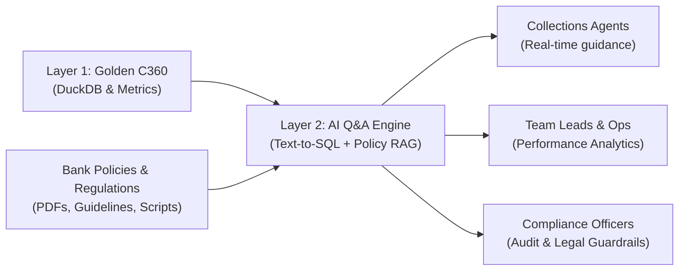
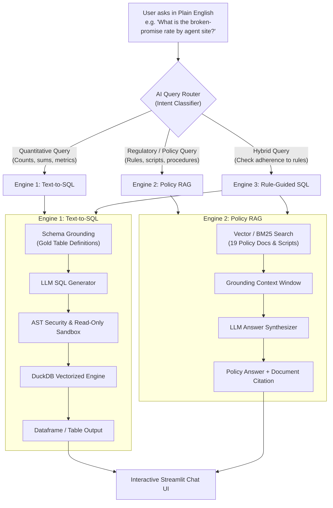

# 🌟 Layer 2: AI Q&A Engine (Talk to Data & Policy) — Beginner-Friendly Guide & Insights

---

## 📖 Table of Contents
1. [What is Layer 2 in Simple Terms?](#1-what-is-layer-2-in-simple-terms)
2. [The Core Bank Problem: Why Plain SQL Isn't Enough](#2-the-core-bank-problem-why-plain-sql-isnt-enough)
3. [The Dual-Engine Architecture (Structured Data vs. Unstructured Policy)](#3-the-dual-engine-architecture-structured-data-vs-unstructured-policy)
4. [Engine 1: Text-to-SQL (Talking to Golden C360 Data)](#4-engine-1-text-to-sql-talking-to-golden-c360-data)
5. [Engine 2: Policy & Regulatory RAG (Talking to Bank Guidelines)](#5-engine-2-policy--regulatory-rag-talking-to-bank-guidelines)
6. [Security, Safety & Guardrails (Preventing Hallucinations & Leaks)](#6-security-safety--guardrails-preventing-hallucinations--leaks)
7. [The Benchmark Suite (35 Real Evaluation Questions)](#7-the-benchmark-suite-35-real-evaluation-questions)
8. [The Streamlit Chat UI: How Users Experience Layer 2](#8-the-streamlit-chat-ui-how-users-experience-layer-2)
9. [Key Metrics Reference & Formula Dictionary](#9-key-metrics-reference--formula-dictionary)
10. [Beginner Glossary (Cheat Sheet)](#10-beginner-glossary-cheat-sheet)

---

## 1. What is Layer 2 in Simple Terms?

In **Layer 1**, we built the **Data Product Factory**:
* We took 31 raw, messy files (~8 GB of bank history).
* Deduplicated and cross-referenced 1,014,879 customers.
* Output clean tables in DuckDB (`gold_c360_customer`, `gold_c360_accounts`, `gold_c360_cases`).

Now, who uses this data?
* **Call center agents** on phone calls with customers.
* **Collections team leads** reviewing weekly team performance.
* **Compliance officers** ensuring no federal or provincial debt collection laws were broken.
* **Risk executives** asking strategic portfolio questions.

None of these people want to write complex SQL joins or read through a 60-page PDF policy manual while on the phone with an upset customer!

> **Layer 2 is the "Conversational Intelligence Engine".**  
> It acts as a 24/7 AI banking analyst. It allows anyone in the bank to ask a plain English question—whether about raw numbers (*"What is the broken promise rate this month?"*) or complex rules (*"Can we call a customer who registered on the Do Not Call list?"*)—and instantly receive a verified, mathematically accurate, and policy-grounded answer.



---

## 2. The Core Bank Problem: Why Plain SQL Isn't Enough

In a modern bank like Maple Bank, answering questions requires two fundamentally different types of knowledge:

### 1. Hard Numbers (Structured Data)
* *"How many accounts are over 90 days past due?"*
* *"What is our total overdue balance in Quebec?"*
* **Challenge:** Non-technical managers don't know DuckDB syntax, table schemas, or how to join `gold_c360_customer` to `gold_c360_accounts`.

### 2. Strict Laws & Operational Rules (Unstructured Documents)
* *"Can we call a customer on Sunday evening in Ontario?"*
* *"What do we do if a customer discloses they filed for bankruptcy?"*
* *"Does CASL express consent apply to payment reminder emails?"*
* **Challenge:** These answers aren't stored as numbers in a database. They live in regulatory summaries (`REG-SUM-001`), hardship manuals (`POL-COLL-004`), and agent scripts (`SCR-MID-STD-EN`).

### 3. The Dangerous "In-Between" (Hybrid Questions)
* *"Did we accidentally make outbound calls outside legal calling hours last month, and what is our violation rate?"*
* To answer this, an AI must **know the legal rule** (e.g. no calls after 9 PM local time) **AND write the SQL query** to check timestamps in `bronze_contact_history`!

Layer 2 solves this by uniting both worlds into a single, cohesive interface.

---

## 3. The Dual-Engine Architecture (Structured Data vs. Unstructured Policy)

Layer 2 uses an intelligent **Query Router** that inspects incoming user queries and delegates them to the appropriate subsystem:



---

## 4. Engine 1: Text-to-SQL (Talking to Golden C360 Data)

### How Text-to-SQL Works Under the Hood
1. **User input:** The user asks: *"How many deceased customers have open accounts?"*
2. **Schema Injection:** The system provides the LLM with the exact schema definitions from `collections_c360/maple.duckdb`:
   ```sql
   Table: gold_c360_customer (golden_id, deceased_flag, ...)
   Table: gold_c360_accounts (golden_id, account_id, current_balance, ...)
   ```
3. **Prompt Grounding:** Strict system rules instruct the LLM:
   * Only write `SELECT` queries.
   * Never modify data (`DROP`, `INSERT`, `UPDATE`, `DELETE` are prohibited).
   * Use ANSI / DuckDB syntax.
4. **Generated SQL:**
   ```sql
   SELECT COUNT(DISTINCT c.golden_id) AS deceased_with_accounts
   FROM gold_c360_customer c
   JOIN gold_c360_accounts a ON c.golden_id = a.golden_id
   WHERE c.deceased_flag = true;
   ```
5. **Execution:** The query runs against DuckDB in under **10 milliseconds** and renders as an interactive table in the UI.

---

## 5. Engine 2: Policy & Regulatory RAG (Talking to Bank Guidelines)

Maple Bank maintains **19 key reference documents** in `bronze_reference_documents`. Layer 2 uses Retrieval-Augmented Generation (RAG) to ensure answers come straight from verified bank documents—not AI imagination.

### Key Policy Documents in the Knowledge Base
| Document ID | Title | Key Governance Focus |
|---|---|---|
| `POL-COLL-001` | **Collections Contact Policy** | Permissible calling hours, frequency limits (max 3 contact attempts per week), Do Not Call list rules. |
| `POL-COLL-004` | **Hardship & Vulnerable Customers Policy** | Mandatory identification of vulnerability, breathing space protocols, suspension of collections. |
| `REG-SUM-001` | **Provincial Collection Rules Summary** | Provice-specific calling hours (e.g., Ontario vs. Quebec vs. Alberta time windows and Sunday calling bans). |
| `PRC-COLL-010` | **Promise-to-Pay Procedure** | Standard terms for PTPs, minimum payment fractions, rescheduling rules. |
| `PRC-COLL-012` | **Dispute Handling Procedure** | Handling billing errors, late-fee disputes, and statutory escalation timelines. |
| `SCR-VUL-EN` | **Vulnerable Customer Script** | Verbatim empathetic phrasing agents must use when customers disclose severe illness or mental distress. |

### Sample Question & RAG Response
* **User Query:** *"Does the National Do Not Call List stop our collection calls?"*
* **Grounding Source:** `POL-COLL-001` Section 3.2
* **AI Output:**
  > **No.** The National Do Not Call List (DNCL) applies to unsolicited telemarketing. Under Canadian law and Maple Bank policy `POL-COLL-001`, debt collection calls regarding existing accounts are exempt from the DNCL. However, agents **must** honor Maple Bank's internal `consent_call` flags and respect provincial permissible calling windows.

---

## 6. Security, Safety & Guardrails (Preventing Hallucinations & Leaks)

Banks operate under severe regulatory oversight (OSFI, FCAC, PIPEDA). An AI that hallucinates or leaks private data can lead to multi-million dollar fines. Layer 2 implements **four strict guardrails**:

```mermaid
flowchart TD
    subgraph G1 ["Guardrail 1: Read-Only Connection"]
        R1["duckdb.connect(..., read_only=True)"]
        R2["Impossible to alter, delete, or inject malicious write queries"]
        R1 --> R2
    end
    
    subgraph G2 ["Guardrail 2: SQL AST Sandboxing"]
        S1["Query Parser inspects SQL syntax tree"]
        S2["Rejects any DDL/DML (DROP, ALTER, CREATE, EXEC)"]
        S1 --> S2
    end
    
    subgraph G3 ["Guardrail 3: Privacy & PII Masking"]
        P1["SIN numbers / full card numbers are never exposed in UI"]
        P2["Masked to last 4 digits (e.g. Card ****-****-****-1234)"]
        P1 --> P2
    end
    
    subgraph G4 ["Guardrail 4: Policy Grounding & Citations"]
        C1["Strict temperature (0.0) for deterministic answers"]
        C2["Must cite specific doc_id (e.g., POL-COLL-001) or say 'I cannot verify'"]
        C1 --> C2
    end
```



---

## 7. The Benchmark Suite (35 Real Evaluation Questions)

To rigorously test that Layer 2 works accurately, the project includes an automated benchmark suite in DuckDB table `bronze_benchmark_questions`.

### Breakdown of the 35 Questions
| Split | Easy | Medium | Hard | Total |
|:---:|:---:|:---:|:---:|:---:|
| **Dev (Training / Calibration)** | 8 | 9 | 4 | **21** |
| **Test (Blind Evaluation)** | 6 | 7 | 1 | **14** |
| **Total** | **14** | **16** | **5** | **35 Questions** |

### Sample Benchmark Questions Across Domains
1. **Compliance (Easy):** `BQ-005` — *"Does the National Do Not Call List stop collection calls?"*
2. **Operations (Medium):** `BQ-002` — *"How many call attempts can we make on a mid-stage account in a week?"*
3. **Analytics (Medium):** `BQ-007` — *"What was the broken-promise rate by agent site for promises due in July-September 2026?"*
4. **Customer Care (Easy):** `BQ-009` — *"A customer tells us they filed a consumer proposal. What should the agent do?"*
5. **Regulatory Audit (Hard):** `BQ-010` — *"What share of outbound calls in September 2026 were outside permitted calling hours, by customer province?"*

---

## 8. The Streamlit Chat UI: How Users Experience Layer 2

The application in [`src/layer2_ai_qa.py`](file:///d:/VACHAN/src/layer2_ai_qa.py) provides a modern, intuitive, web-based chat experience:

1. **Natural Language Input:** Users type questions into an interactive chat box just like ChatGPT.
2. **Transparent Query Inspection:** An expandable `🔍 View generated SQL` box shows the exact SQL query generated by the AI, building trust and allowing data analysts to audit the code.
3. **Live Interactive Dataframes:** Results are rendered directly as searchable, scrollable data tables.
4. **Session History:** Keeps track of past questions and answers during the working session.

### How to Run the Web App Locally:
```powershell
# Activate your project virtual environment
.\venv\Scripts\Activate.ps1

# Launch the Streamlit application
streamlit run src/layer2_ai_qa.py
```

---

## 9. Key Metrics Reference & Formula Dictionary

When asking quantitative questions, Layer 2 uses standard banking formulas defined in `bronze_metric_definitions`:

| Metric Name | Short Definition | Exact SQL Mathematical Formula | Direction |
|---|---|---|:---:|
| **Broken Promise Rate** | Share of resolved promises that were broken | `COUNT(ptp_status = 'broken') / COUNT(ptp_status IN ('kept', 'partially_kept', 'broken'))` | 📉 Lower is better |
| **Cure Rate** | Share of delinquent cases returning to current status | `COUNT(cured_cases) / COUNT(open_cases)` | 📈 Higher is better |
| **Right-Party Contact (RPC) Rate** | Share of outbound calls that reached the actual customer | `COUNT(rpc_flag AND outbound) / COUNT(outbound_calls)` | 📈 Higher is better |
| **PTP Rate** | Promises taken per right-party contact | `COUNT(ptp_made_flag) / COUNT(rpc_flag)` | 📈 Higher is better |
| **Average DPD** | Mean days past due of delinquent open cases | `AVG(current_dpd)` | 📉 Lower is better |
| **Cost Per RPC** | Total outreach operational cost divided by successful contacts | `SUM(contact_cost_cad) / COUNT(rpc_flag)` | 📉 Lower is better |

---

## 10. Beginner Glossary (Cheat Sheet)

* **Text-to-SQL:** Using a language model to translate a plain English question into executable SQL code.
* **RAG (Retrieval-Augmented Generation):** Pulling relevant factual snippets from real documents before having the AI answer, preventing false statements.
* **AST (Abstract Syntax Tree):** A tree representation of code structure used to inspect queries and block dangerous commands before execution.
* **RPC (Right-Party Contact):** When an outbound phone call reaches the actual person who owes the money, rather than a voicemail, wrong number, or relative.
* **PTP (Promise to Pay):** A formal commitment made by a debtor during a collection call to pay a specified amount by a specified date.
* **CASL:** Canada's Anti-Spam Legislation, governing electronic commercial messaging and consent.
* **Consumer Proposal:** A legally binding Canadian debt relief process under the Bankruptcy and Insolvency Act where a debtor negotiates to pay a percentage of debt.
* **Zero-Copy Querying:** Reading data directly from underlying analytical storage (DuckDB) without moving or copying files into memory.

---
*Created as part of the Maple Bank Collections 360 AI Platform.*
